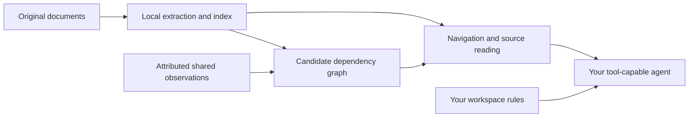

# Synapse KB

**Find the rule. Follow the exception. Keep the evidence.**

Local document navigation, dependency candidates and shared observations for
LLM agents with filesystem and terminal access. Start with a folder you already
have; let your agent guide the setup and apply your own working rules.

**Status: alpha, 0.2.0a1.** This is a working toolkit and an experimental contract
for evidence navigation. It is not an established standard or a proven improvement
in model accuracy. See [evaluation](docs/EVALUATION.md) and [limitations](docs/LIMITATIONS.md).

[Italiano](README.it.md) · [Agent setup](docs/ONBOARDING.md) ·
[Commands](docs/CLI.md) · [Architecture](docs/ARCHITECTURE.md) ·
[0.2 review and benchmarks](docs/EVOLUTION.md) ·
[Before publishing](docs/PUBLISHING.md)

## Try it

Requires Python 3.11+ with SQLite FTS5. No API key or model SDK is needed by the
indexing engine. The demo and non-PDF extraction work without installing packages.

```sh
git clone https://github.com/TizianoCarpentieri/synapse-kb.git
cd synapse-kb
python atlas.py doctor
python atlas.py init --demo --workspace workspaces/demo
python atlas.py search "Orion return window" --workspace workspaces/demo
```

Copy a complete `nNUMBER-hash` reference from the results:

```sh
python atlas.py read REFERENCE --workspace workspaces/demo --vicini 1
```

`REFERENCE` is a placeholder. The fictional demo has a return policy in one file,
an exception in another, prerequisites and scope distinctions. Related evidence
appears **before** the source text and is also available in JSON.

Open `workspaces/demo/_atlas/visuals/graph.html` in a browser for the offline graph.
Open its `obsidian/` sibling as a vault for bidirectional Markdown links. Both
are bounded snapshots; their counts disclose what is included and omitted.

## Let your agent guide you

Open the cloned repository in an agent that can read local files and run commands.
Send:

> Read AGENTS.md and help me set up Synapse KB. Ask whether I already have a
> documentation folder and whether I want custom rules or defaults. Guide me
> one step at a time, then verify the setup with a search and a source reading.

The agent configures a **separate workspace**, connects your existing source
folder without moving or editing it, and writes local rules and instructions.
Open the resulting workspace for everyday use. An agent that recognizes
[AGENTS.md](https://agents.md/) can discover those instructions; other hosts need
an explicit instruction to read the file. Chat-only models cannot do this themselves.

The repository does not install or launch an LLM. There is no bundled chat UI,
model subscription, automatic host configuration or guarantee that a resumed
session reloads updated instructions.

## Use your own documents

```sh
python atlas.py init --source "/path/to/documents" --workspace workspaces/main
```

On Windows, use a quoted path such as `"D:\Documentation"`. To provide your own
rules, add `--rules-file "/path/to/rules.md"`. To start with an empty collection:

```sh
python atlas.py init --empty --workspace workspaces/main
```

Add documents to `workspaces/main/documents/`, then run:

```sh
python atlas.py update --workspace workspaces/main
python atlas.py status --workspace workspaces/main
```

For PDF text extraction, install the tested optional dependency:

```sh
python -m pip install "pypdf==6.21.1"
```

Scanned PDFs require a separate OCR workflow. Extracted text does not preserve
all visual layout, tables or images. See [format support](docs/FORMATS.md).

## What makes this useful

- Original document paths, H1–H6 context, source hashes and continuation cursors.
- Local full-text search and structural navigation, without embeddings.
- Candidate exceptions, prerequisites, scope limits and superseding notices
  across files, plus links and cited headings a document states itself. Each
  candidate names its relation, its origin and the byte range of its cue.
- Attributed shared notes, explicit links, expiry and revocation. Notes start as
  **proposed observations**, separate from source evidence.
- Notes follow their passage through edits while the annotated text is
  identical; changed text becomes a flagged proposal for a person to accept.
- A hash-chained journal of every index and memory change; concurrent readers;
  memory import between workspaces.
- An MCP stdio server (`python atlas.py serve --workspace workspaces/main`)
  with the same operations and change notifications. Standard library only.
- HTML and Obsidian graph views with no CDN or server requirement.
- Source code, synthetic regression tests, portable build script and a draft
  [interoperability contract](docs/CONTRACT.md).



## Precise boundaries

The engine makes **zero LLM calls and no network requests** during indexing,
search, graph construction and export. Your agent may send returned text to its
model provider; its privacy policy and deployment remain separate.

This is **not zero-ingest or chunkless**: Synapse KB extracts normalized text,
stores SQLite FTS5 data and splits long sections into bounded reading passages.
It does not require vector embeddings or a full-corpus LLM rewrite. Dependency
scores are lexical rankings, not verified logic or confidence probabilities.

Automatic memory is an observation mechanism, not autonomous policy learning.
Manual links survive updates. A note is re-attached automatically only where
its annotated text is found again unchanged, once, in the same file and under
the same headings. A changed passage is proposed for review, never assumed.

## Build and verify

```sh
python -m pip install -r requirements-dev.txt
python pack.py
python -m unittest discover -v
python scripts/evaluate_demo.py
python scripts/benchmark.py reconcile
python scripts/audit_public.py
python -m build
```

`dist/atlas.pyz` bundles the engine and pypdf for use with Python, without package
installation on the destination machine. The demo is distributed with the source
repository, not the portable executable. Keep its license notices with it.

An optional package installation exposes the `synapse-kb` command:

```sh
python -m pip install ".[pdf]"
synapse-kb doctor
```

The source checkout is the recommended onboarding path in this alpha.

## Contribute

See [CONTRIBUTING.md](CONTRIBUTING.md), [security](SECURITY.md),
[roadmap](docs/ROADMAP.md) and [governance](GOVERNANCE.md).
Useful contributions include independently labelled dependency examples,
reproducible agent evaluations, multilingual rules and portability fixes.

MIT license for this repository. Third-party notices are in
[THIRD_PARTY_NOTICES.md](THIRD_PARTY_NOTICES.md). Indexed documents retain their
own rights and are not included in the project license.
